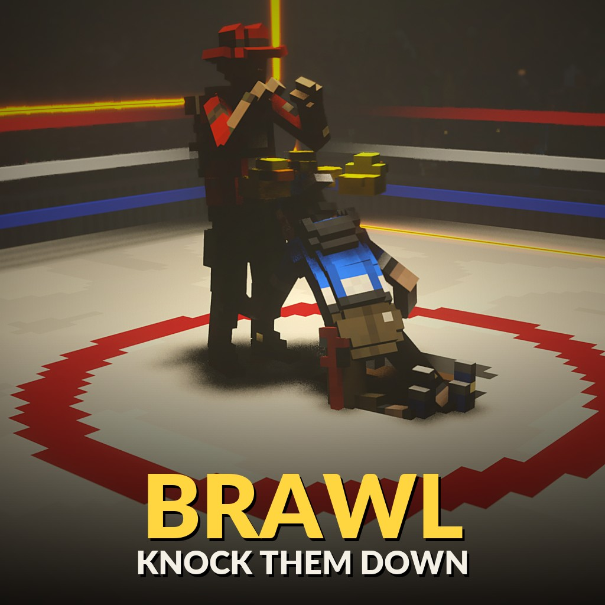

# Brawl - a team fist-fight game mode for any map



On the Steam Workshop: [Brawl](https://steamcommunity.com/sharedfiles/filedetails/?id=3833372098)

Teams (2-4, the host picks) brawl inside a fight area. Damage only counts inside it: a hit on someone outside, or
from someone outside, does nothing. Inside, after 5 s without taking damage you heal slowly; outside you never heal.
Everyone spawns outside the area, each team on its own side. At 0 health inside you are KNOCKED DOWN: kneeling
for 10 s with chicks circling your head, unable to move or hit, with a second health bar - more hits empty it and you
are out of the round (spectating); hold out and you get back up with a third of your health. A knockdown scores for
the attacker's team, an elimination once more. The last team with fighters left wins; when the timer reaches 0:00
the team with the most of its starting health left, as a percentage (fair for smaller teams; knocked fighters
count 0), then knockdowns, then damage. Players who join mid-round spectate and play from the next round.

- Enable the **Combat System** mod (Workshop 3822172014) as a global mod and everyone fights with bare hands
  (punches, kicks, blocks): every other tool is taken away. Without it, everyone fights with weapons (lobby setting).
- **Tab** shows the scoreboard (teams, KOs, damage dealt, deaths).
- The lobby shows the map from above as a cross-section: everything lying wholly above a height (roofs, ceilings) is
  hidden - the bar at the right shows "Hide above: 9.7 m"; on auto it sits just under the ceiling of the building in
  view. WASD: move, wheel: zoom; the host: Q / E lower / raise the height (manual), R: auto again.
- The host can draw the fight area in the lobby: **Edit fight area** - drag the corners in that view; or click and
  drag inside the area to move the whole thing (it lands on the floor where you drop it).

## For map and mod makers: the fight-area API

The mode reads the host's registry (set it from a server script; no sync needed). First match wins:

1. The host's own polygon drawn in the lobby (for that session).
2. `brawl.area` (string), set before or while the lobby runs; re-read every second. Parts separated by `;`:
   - `box x0 y0 z0 x1 y1 z1` - an axis-aligned world box (metres, any two opposite corners)
   - `cyl x y z radius height` - a vertical cylinder standing on y, up to y + height
   - `poly y0 y1 x1 z1 x2 z2 x3 z3 ...` - a vertical prism: a polygon in x/z (3-32 corners, concave is fine)
     from y0 up to y1
   - `zone floor x1 z1 x2 z2 x3 z3 ...` - a polygon with no height limit: every floor inside it counts (what the
     host's editor makes); `floor` is the level its outline is drawn at and spawns are placed next to
   ```lua
   SetString("brawl.area", "box -6 0 -6 6 5 6")              -- a 12 m ring, 5 m high
   SetString("brawl.area", "cyl 0 0 0 10 8;box 20 0 -4 28 4 4")
   ```
3. Triggers in the map tagged `brawl_area` (`<trigger tags="brawl_area" .../>`).
4. None: the whole map counts.

A player is inside when the point 0.5 m above their feet is inside any part.

What the mode publishes (host registry, unsynced):

| key | |
|---|---|
| `brawl.active` (bool) | true from the round's countdown until the results show. While it is true the mode respawns players: a map must not |
| `brawl.phase` (string) | `lobby`, `ready` (3 s countdown), `fight`, `over` (results) |
| `brawl.knocked.<p>` (bool) | true while player p is knocked down (kneeling; e.g. block a map's mantle for them) |
| `brawl.event.last` (int) | the newest event's number; it only grows (it survives Play Again) |
| `brawl.event.<n % 16>.kind` | `round_start` (the fight begins), `round_end`, `knockdown`, `getup`, `eliminated`, `combo` |
| `.victim`, `.attacker` (int) | player ids (0: none / the world); `eliminated`: the attacker who finished them |
| `.team` (int) | `round_end`: the winning team (0: a draw); `knockdown` / `eliminated` / `combo`: the attacker's team (0: no point scored); `getup`: the victim's team |
| `.hits` (int) | `combo`: hits in the chain so far (3 and up; one event per further hit) |
| `.time` (float) | GetTime() when it happened |

The fields are written first, the counter last. A reader:

```lua
local seen = GetInt("brawl.event.last")
function server.tick(dt)
	local last = GetInt("brawl.event.last")
	if last < seen then seen = last end
	for n = math.max(seen + 1, last - 15), last do
		local k = "brawl.event." .. (n % 16)
		local kind = GetString(k .. ".kind")
		if kind == "knockdown" then --[[ the crowd roars ]] end
	end
	seen = last
end
```

## Community

Join the [Discord community](https://discord.gg/gNpRewdkxf) to post bug reports and suggestions.

## Install

Subscribe on the [Steam Workshop](https://steamcommunity.com/sharedfiles/filedetails/?id=3833372098), or clone this repository into
`Documents/Teardown/mods/brawl`. The host picks it as the game mode when starting a multiplayer session.

## Credits

Made by AgeOfAlgorithms and Claude (Anthropic). MIT licence.
